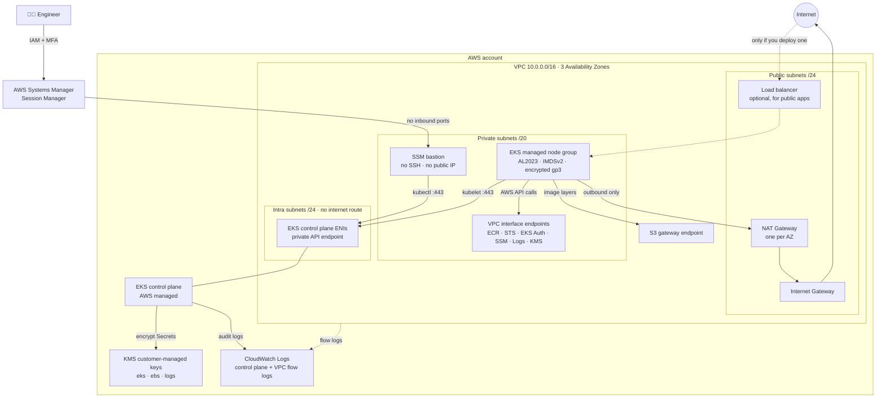
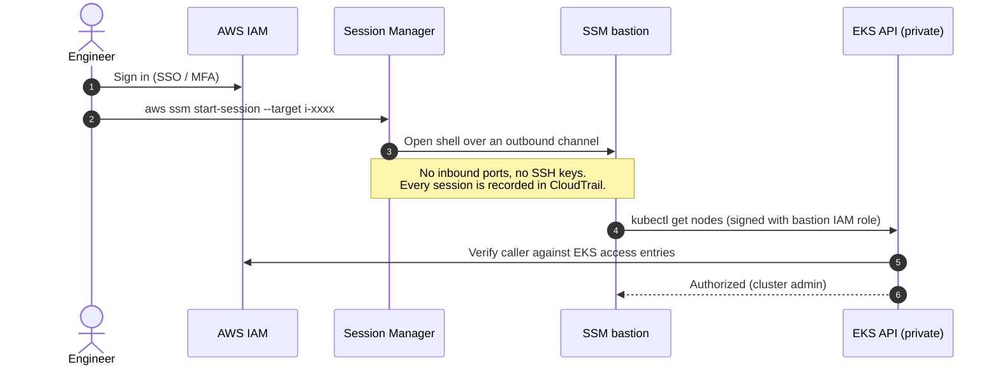
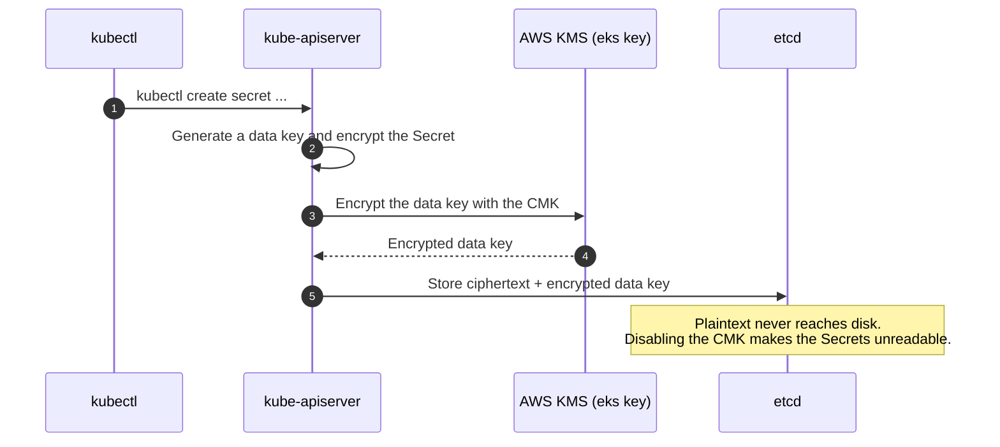
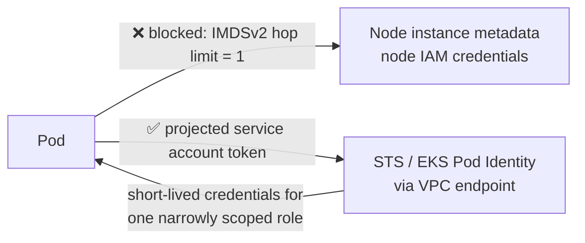
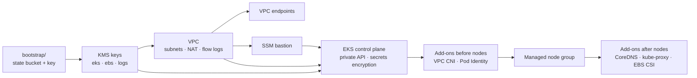
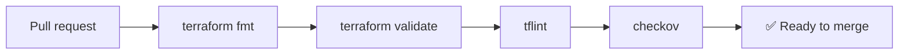

# Secure EKS on AWS with Terraform


A production-ready, **security-first Amazon EKS cluster** built with Terraform. Nothing in the cluster is reachable from the internet unless you explicitly expose it, and everything that stores data is encrypted with your own KMS keys.

- 🔒 **Private by default**: worker nodes in private subnets, control plane in isolated subnets, private Kubernetes API endpoint
- 🔑 **Customer-managed KMS keys** with automatic rotation for Kubernetes Secrets, EBS volumes and logs
- 🛡️ **No SSH anywhere**: admin access via AWS Systems Manager Session Manager, authenticated by IAM and logged
- 🪪 **Least-privilege identity**: EKS access entries (no `aws-auth` ConfigMap), IRSA / Pod Identity, IMDSv2 with hop limit 1
- 📜 **Full audit trail**: all 5 control plane log types + VPC flow logs, encrypted in CloudWatch
- ✅ **CI-enforced quality**: `terraform fmt`, `validate`, `tflint` and `checkov` on every pull request

---

## Architecture



### Why three subnet tiers?

| Tier | Size | What lives there | Internet access |
|---|---|---|---|
| **Public** | /24 per AZ | NAT gateways, optional internet-facing load balancers | Inbound + outbound |
| **Private** | /20 per AZ (4,096 IPs) | Worker nodes, pods, bastion, VPC endpoints | Outbound only, via NAT |
| **Intra** | /24 per AZ | EKS control plane network interfaces | **None** |

The private subnets are large on purpose: the VPC CNI gives every pod a real VPC IP address, so small subnets run out of IPs long before they run out of CPU.

---

## How it works

### 1. Admin access: no SSH, no public API



### 2. Kubernetes Secrets: envelope encryption with your KMS key



### 3. Pod-to-AWS access without node credentials



Pods cannot borrow the node's IAM role. Each workload gets its own role, like the EBS CSI driver, which can use only the `ebs` KMS key.

### 4. Deployment order

Terraform works out the dependency graph automatically. This is the order resources come up in:



### 5. CI pipeline



---

## Security controls

| Area | Control | Where |
|---|---|---|
| Network | Nodes have no public IPs; control plane ENIs are in subnets with no internet route | [`vpc.tf`](vpc.tf) |
| Network | Kubernetes API is private; public access needs an explicit CIDR allowlist and `0.0.0.0/0` is rejected | [`eks.tf`](eks.tf), [`variables.tf`](variables.tf) |
| Network | Default security group stripped of all rules | [`vpc.tf`](vpc.tf) |
| Network | AWS API traffic (ECR, STS, SSM, KMS, Logs) stays inside the VPC through private endpoints | [`modules/vpc-endpoints`](modules/vpc-endpoints) |
| Network | Kubernetes `NetworkPolicy` enforced natively by the VPC CNI | [`eks.tf`](eks.tf) |
| Encryption | Separate customer-managed KMS keys for Secrets, EBS and logs, with automatic rotation | [`kms.tf`](kms.tf), [`modules/kms`](modules/kms) |
| Encryption | Envelope encryption of Kubernetes Secrets in etcd | [`eks.tf`](eks.tf) |
| Encryption | All EBS volumes (nodes, bastion, PVCs) encrypted with the `ebs` key | [`eks.tf`](eks.tf), [`modules/ssm-bastion`](modules/ssm-bastion) |
| Identity | EKS access entries (`authentication_mode = "API"`) instead of the `aws-auth` ConfigMap | [`eks.tf`](eks.tf) |
| Identity | IMDSv2 required, hop limit 1: pods can't steal node credentials | [`eks.tf`](eks.tf) |
| Identity | IRSA role for the EBS CSI driver, scoped to the `ebs` key only | [`eks.tf`](eks.tf) |
| Access | No SSH keys or open ports; Session Manager only, logged in CloudTrail | [`modules/ssm-bastion`](modules/ssm-bastion) |
| Logging | API, audit, authenticator, controllerManager and scheduler logs | [`eks.tf`](eks.tf) |
| Logging | VPC flow logs (all traffic, 60s aggregation) | [`vpc.tf`](vpc.tf) |
| State | Remote state in S3: versioned, KMS-encrypted, public access blocked, TLS-only, native locking | [`bootstrap/`](bootstrap) |
| Supply chain | Provider and module versions pinned; `kubectl` on the bastion verified by SHA-256 | [`versions.tf`](versions.tf) |

---

## Repository structure

```
.
├── bootstrap/               # One-time: encrypted S3 bucket for remote state
├── modules/
│   ├── kms/                 # Reusable CMK with rotation + scoped key policy
│   ├── vpc-endpoints/       # S3 gateway + private interface endpoints
│   └── ssm-bastion/         # SSH-less admin host (Session Manager only)
├── .github/workflows/       # fmt · validate · tflint · checkov
├── versions.tf              # Terraform/provider pins, S3 backend
├── providers.tf             # Provider, default tags, shared locals
├── variables.tf             # All inputs, with validation
├── kms.tf                   # eks / ebs / logs keys
├── vpc.tf                   # 3-tier VPC, NAT, flow logs, endpoints
├── eks.tf                   # Cluster, add-ons, node group, IRSA
├── bastion.tf               # SSM bastion wiring
├── outputs.tf
├── terraform.tfvars.example
└── backend.hcl.example
```

---

## Quick start

**Prerequisites:** Terraform ≥ 1.10, AWS CLI v2, the [Session Manager plugin](https://docs.aws.amazon.com/systems-manager/latest/userguide/session-manager-working-with-install-plugin.html), and an IAM identity that can create VPC, EKS, IAM and KMS resources.

```bash
# 1. Create the remote state bucket (once per account)
cd bootstrap
terraform init && terraform apply
cd ..

# 2. Configure
cp backend.hcl.example backend.hcl            # set `bucket` to the bootstrap output
cp terraform.tfvars.example terraform.tfvars  # adjust region, sizes, cost options

# 3. Deploy (about 15-20 minutes)
terraform init -backend-config=backend.hcl
terraform plan -out tfplan
terraform apply tfplan

# 4. Connect
terraform output -raw connect
```

### Verify the security controls

From the bastion:

```bash
# Nodes are up
kubectl get nodes -o wide

# API endpoint is private-only
aws eks describe-cluster --name secure-eks-dev \
  --query 'cluster.resourcesVpcConfig.{private:endpointPrivateAccess,public:endpointPublicAccess}'

# Secrets are encrypted with the customer-managed key
aws eks describe-cluster --name secure-eks-dev --query 'cluster.encryptionConfig'

# Pods cannot reach node credentials (this should time out)
kubectl run imds-test --rm -it --restart=Never --image=curlimages/curl -- \
  curl -s -m 5 -X PUT http://169.254.169.254/latest/api/token \
  -H "X-aws-ec2-metadata-token-ttl-seconds: 60" || echo "blocked ✅"
```

### Tear down

```bash
terraform destroy
```

KMS keys enter a 30-day pending-deletion window. The state bucket in `bootstrap/` has `prevent_destroy` set so it can't be deleted by accident.

---

## Cost estimate

Approximate monthly cost in `us-east-1` with default settings:

| Component | Production (default) | Demo mode¹ |
|---|---|---|
| EKS control plane | $73 | $73 |
| 2 × t3.large nodes | $121 | $121 |
| NAT gateways | $99 (3) | $33 (1) |
| Interface endpoints (10 × 3 AZs) | $219 | $0 |
| Bastion, EBS, KMS, logs | ~$25 | ~$25 |
| **Total** | **~$537 / month** | **~$252 / month (~$0.35 / hour)** |

¹ `single_nat_gateway = true` and `enable_interface_endpoints = false` in `terraform.tfvars`. Spinning it up for a couple of hours to test costs about a dollar. **Remember to destroy it afterwards.**

---

## Design decisions

- **Community modules for VPC and EKS, custom modules for the rest.** [`terraform-aws-modules`](https://github.com/terraform-aws-modules) are battle-tested and widely understood by other engineers. The security-specific pieces (KMS, endpoints, bastion) are small custom modules, so every line of policy is visible and reviewable.
- **One KMS key per purpose.** Revoking or auditing one data class doesn't affect the others, and each key policy grants only what its service needs.
- **Bastion over a public API with an IP allowlist.** IP allowlists break with home or VPN IP changes and still expose the endpoint. Session Manager needs no open ports and ties every session to an IAM identity.
- **Access entries over `aws-auth`.** Cluster access is managed through the EKS API and IAM, so it can't be broken by a bad `kubectl edit configmap`.
- **AL2023 managed nodes.** AWS handles AMI updates and node draining. Karpenter can be added on top (subnets are already tagged for discovery).

## Troubleshooting

<details>
<summary><b>Node group fails with a KMS error about <code>AWSServiceRoleForAutoScaling</code></b></summary>

The Auto Scaling service-linked role doesn't exist yet in brand-new accounts. Create it once, then re-apply:

```bash
aws iam create-service-linked-role --aws-service-name autoscaling.amazonaws.com
```
</details>

<details>
<summary><b><code>kubectl</code> times out from my laptop</b></summary>

Expected: the API is private. Connect through the bastion (`terraform output -raw connect`), or set `endpoint_public_access = true` with your IP in `endpoint_public_access_cidrs`.
</details>

## Roadmap

- [ ] Karpenter for just-in-time, cost-optimised node provisioning
- [ ] AWS Load Balancer Controller + ExternalDNS via Pod Identity
- [ ] Argo CD for GitOps application delivery
- [ ] Kyverno policies (no privileged pods, required resource limits, signed images)
- [ ] GuardDuty EKS Runtime Monitoring

---

## About

Built by **Kaustubh Mishra**, a Senior DevOps Engineer with 8 years of experience running production Kubernetes and AWS infrastructure.

Need something like this for your team? [Hire me on Upwork](https://www.upwork.com/freelancers/~01a4ea16dfe20bb332).

Licensed under [MIT](LICENSE).
